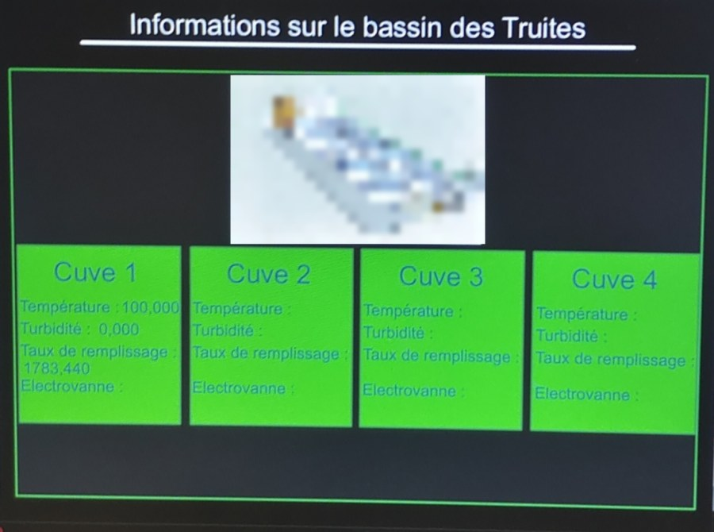
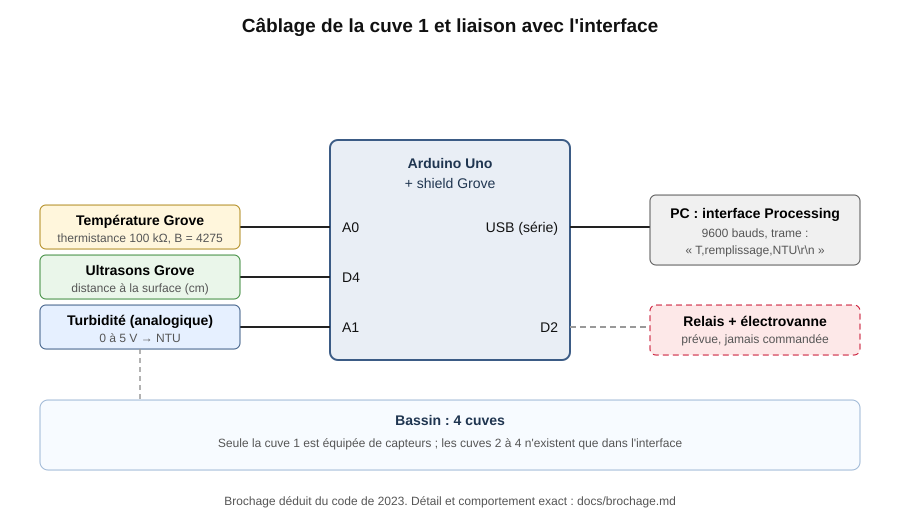
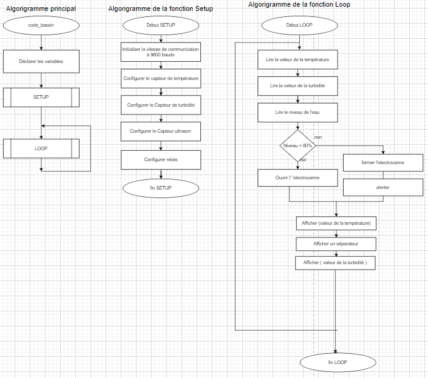
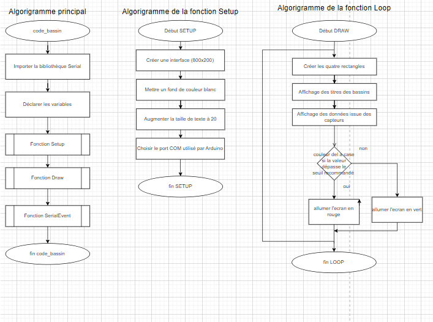
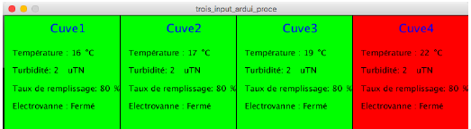
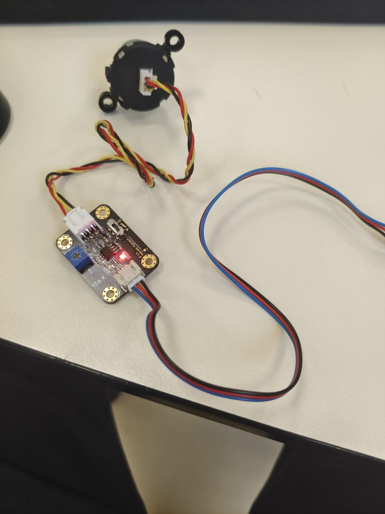
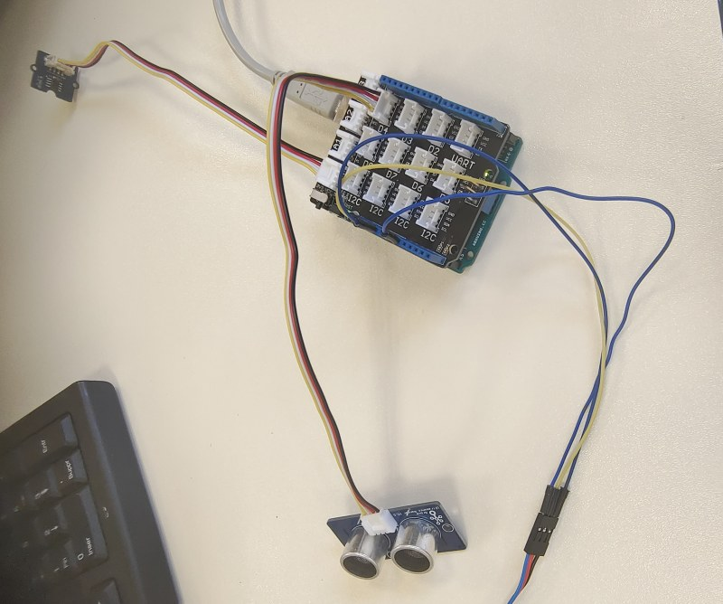

# Supervision de cuves d'élevage de truites (Arduino + Processing)

🇫🇷 [Français](#français) · 🇬🇧 [English](#english)



---

## Français

### Contexte
Projet de **terminale STI2D, option SIN** (décembre 2022 – mars 2023), sur le thème de l'aquaculture. La truite demande une eau de qualité constante :
- une température idéale entre **12 et 17 °C** ; elle souffre dès **20 °C** et meurt vers **24 °C** ;
- une eau claire ;
- des bassins toujours remplis.

Le système conçu ici **surveille automatiquement les cuves d'un bassin d'élevage** :
- il mesure la **température**, la **turbidité** et le **taux de remplissage** de chaque cuve ;
- il prévoit une **électrovanne** pour remplir une cuve quand le niveau descend sous 80 % ;
- il affiche le tout sur une **interface Processing** de supervision des 4 cuves.

### Architecture



| Fonction | Composant | Rôle |
|---|---|---|
| Traiter | Arduino Uno + shield Grove | Lit les capteurs et envoie une trame série |
| Mesurer la température | Capteur de température Grove (thermistance NTC 100 kΩ) | Température de l'eau, en °C |
| Mesurer la qualité de l'eau | Capteur de turbidité analogique | Turbidité, en NTU |
| Mesurer le niveau | Télémètre à ultrasons Grove | Distance à la surface, convertie en taux de remplissage |
| Remplir | Relais + électrovanne | Ouvrir l'arrivée d'eau |
| Superviser | PC + Processing | Affichage des 4 cuves |

Le détail des broches, des formules et du comportement exact du code est dans [`docs/brochage.md`](docs/brochage.md).

### Algorithmes

| Arduino | Processing |
|---|---|
|  |  |

### Programme Arduino : [`code/arduino/supervision_cuve`](code/arduino/supervision_cuve)
À chaque tour de boucle, le programme :
1. calcule la **température** à partir de la thermistance (loi en B, B = 4275) ;
2. calcule le **taux de remplissage** à partir de la distance mesurée par l'ultrason ;
3. calcule la **turbidité** à partir de la tension du capteur (polynôme d'étalonnage du fabricant) ;
4. envoie la trame `température,remplissage,turbidité` sur le port série, à 9600 bauds.

Le fichier `.ino` d'origine n'a pas été conservé. Ce programme est une **transcription fidèle des captures d'écran de mon diaporama de 2023**. À la relecture, aucune ligne n'empêchait la compilation, donc je n'ai rien corrigé.

### Interface Processing : [`code/processing`](code/processing)
- **`maquette_4_cuves`** : la première maquette statique de l'écran, avec 4 cuves, des valeurs fixes et la cuve 4 en rouge pour montrer une alerte.

  

- **`interface_bassin`** : l'interface connectée. Je suis **parti d'un exemple d'interface AranaCorp** (« Simple Interface », bibliothèque ControlP5) et je l'ai adapté :
  - retrait des widgets d'exemple (bouton, liste, case à cocher, champ de texte) ;
  - **lecture du port série** et découpage de la trame en 3 valeurs ;
  - dessin du titre, du cadre et des **4 cuves** ;
  - affichage en direct des **3 mesures de la cuve 1**.

  Pour la publication, j'ai renommé le titre de la fenêtre (il s'appelait encore « AranaCorp - Simple Interface »). J'ai aussi remplacé une illustration téléchargée par un dessin des cuves fait dans le code, à la même place et à la même taille.

### Test
Les capteurs ont été câblés et testés sur table, et l'interface a été lancée avec l'Arduino branché (photo en haut de page ; l'illustration téléchargée y est floutée).

| Capteur de turbidité | Shield Grove et ultrason |
|---|---|
|  |  |

---

### Vérification en 2026
En reprenant le projet, j'ai relu le code et la photo de l'écran comme on relit un système avant de le mettre en service. Voici ce que cette relecture fait ressortir et ce que je ferais pour une version 2.

1. **Taux de remplissage : rapporter la mesure à la vraie cuve.** Le calcul `(2000 − d)·100/2000` revient à supposer une cuve de 20 m de profondeur : pour une cuve réelle, il donne toujours un résultat proche de 100 %. Il faut partir des hauteurs mesurées « cuve vide » (d_vide) et « cuve pleine » (d_plein) : `remplissage = (d_vide − d) / (d_vide − d_plein) × 100`, borné entre 0 et 100 %.
2. **Électrovanne : coder la règle de l'algorigramme.** La broche D2 est préparée, mais la règle « niveau < 80 % → ouvrir » de l'algorigramme n'est pas encore dans le programme. Pour éviter que la vanne batte autour du seuil, il faut une hystérésis : ouvrir sous 80 %, fermer au-dessus de 90 %. Il faut aussi faire remonter l'état de la vanne dans la trame, pour l'afficher.
3. **Alertes : passer de la maquette à l'interface connectée.** La maquette montre l'alerte en rouge, mais l'interface connectée n'a pas encore de seuils. Pour la truite, les seuils évidents sont **20 °C** (stress) et **24 °C** (danger), une turbidité anormale et un niveau trop bas. Chaque cuve doit passer à l'orange ou au rouge en fonction de ces seuils.
4. **Lecture série : diagnostic de la photo de l'écran.** Sur la photo du test, la cuve 1 affiche *Température 100*, *Turbidité 0* et *Remplissage 1783*. Ces nombres ne sont pas à leur place :
   - 100 % est exactement ce que donne le calcul de remplissage quand l'ultrason ne reçoit pas d'écho (d = 0) ;
   - environ 1 800 NTU est une valeur typique du capteur de turbidité.

   La trame reçue par Processing n'avait donc pas la structure attendue : décalage d'une valeur, ou trame d'une version précédente du programme. Deux points du code favorisent ce genre de problème. Côté Arduino, la boucle n'a pas de `delay` et inonde le port série. Côté Processing, le code lit `values[1]` et `values[2]` après avoir seulement vérifié `values.length > 0`. Pour une version 2 : une trame balisée (`T=…;R=…;N=…`), une vérification du nombre de champs, une mesure par seconde, et le choix du port dans l'interface plutôt que `Serial.list()[2]`.
5. **Turbidité : respecter le domaine de la formule.** Le polynôme d'étalonnage n'est valable qu'entre 2,5 et 4,2 V environ. En dehors de cette plage, il donne des valeurs négatives (−4 353 NTU à 0 V). Il faut borner la tension, signaler « hors plage » et étalonner le capteur avec une eau claire.
6. **Matériel : adapter les capteurs à l'eau, puis multiplier par 4.** Le module de température Grove n'est pas étanche : pour une mesure dans l'eau, une sonde étanche, comme le DS18B20, convient mieux. Aujourd'hui, seule la cuve 1 est équipée. Pour 4 cuves, il faut 4 jeux de capteurs : un bus 1-Wire commun pour les sondes de température, des entrées analogiques ou un multiplexeur pour la turbidité, et 4 télémètres.

### Ce que le projet m'a appris
- partir d'un besoin biologique (les seuils de la truite) pour définir les grandeurs à mesurer ;
- faire dialoguer un microcontrôleur et une interface PC par une **liaison série** ;
- **réutiliser un exemple existant en le citant**, puis l'adapter à son besoin ;
- et, avec le recul : **une valeur affichée qui n'a pas de sens est un indice** à exploiter (ici, sur le format de la trame série).

### Contenu du dépôt
```
code/arduino/supervision_cuve/   programme Arduino final (transcrit des captures de 2023)
code/processing/interface_bassin/ interface connectée (adaptée d'un exemple AranaCorp)
code/processing/maquette_4_cuves/ maquette statique des 4 cuves
docs/brochage.md                  broches, trame série, formules, comportement exact, seuils
images/                           schéma de câblage (SVG), algorigrammes, maquette, photos
```
Logiciels : IDE Arduino (bibliothèque Grove « Ultrasonic Ranger » de Seeed) et Processing 3 (bibliothèque Serial, incluse).

---

## English

### Context
Final-year project in **STI2D, digital systems option** (French technology high-school track, December 2022 – March 2023), on fish farming. Trout need water at **12 to 17 °C** (stress from 20 °C, death around 24 °C), clear water and full tanks. The system **monitors the tanks of a fish farm automatically**: it measures **temperature**, **turbidity** and **fill level**, plans a **solenoid valve** to refill a tank below 80 %, and shows everything on a **Processing dashboard** for 4 tanks.

### Hardware and software
- **Hardware:** Arduino Uno with a Grove shield; Grove thermistor on A0, Grove ultrasonic ranger on D4, analog turbidity sensor on A1, relay and solenoid valve on D2.
- **Arduino:** the Arduino sends `temperature,fill,turbidity` over serial at 9600 baud. The original `.ino` file was lost, so the program here is a **faithful transcription of the screenshots in my 2023 slides** (nothing needed fixing to compile).
- **Processing:** the Processing dashboard **started from an AranaCorp example** ("Simple Interface", ControlP5). I adapted it by removing the sample widgets and adding serial reading, the 4 tanks and live display for tank 1. For publication, I renamed the window title and replaced a downloaded picture with a drawing made in code.
- **Details:** see [`docs/brochage.md`](docs/brochage.md) for pins, frame format, formulas and exact behaviour.

### 2026 verification
1. **Fill level:** the formula assumes a 20 m deep tank. It should use the measured empty and full distances, clamped to 0–100 %.
2. **Valve:** the "level < 80 % → open" rule from the flowchart is not yet coded. It should be added with hysteresis, and the valve state should be sent back in the frame.
3. **Alerts:** only the static mock-up shows a red alert. The live dashboard needs thresholds (20 °C and 24 °C for trout, turbidity, low level).
4. **Serial reading:** the test photo shows *Temperature 100*, *Turbidity 0*, *Fill 1783*. 100 % is exactly the fill value when the ultrasonic sensor gets no echo, and about 1,800 NTU is a typical turbidity value, so the frame did not have the expected structure. An Arduino loop with no `delay` and a Processing check limited to `values.length > 0` make this possible. Version 2 would use a tagged frame, a field-count check, one reading per second, and port selection in the dashboard.
5. **Turbidity:** the calibration polynomial is only valid for about 2.5 to 4.2 V. The voltage should be clamped and the sensor calibrated.
6. **Hardware:** a waterproof temperature probe (such as a DS18B20) is better suited to water, and 4 sensor sets are needed for 4 tanks (only tank 1 is wired).

### What I learned
Deriving measurements from a biological need, linking a microcontroller to a PC dashboard over serial, **reusing an existing example and crediting it**, and treating a nonsensical displayed value as a clue.
